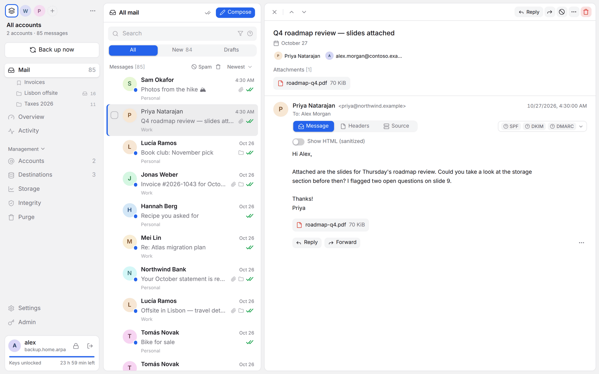
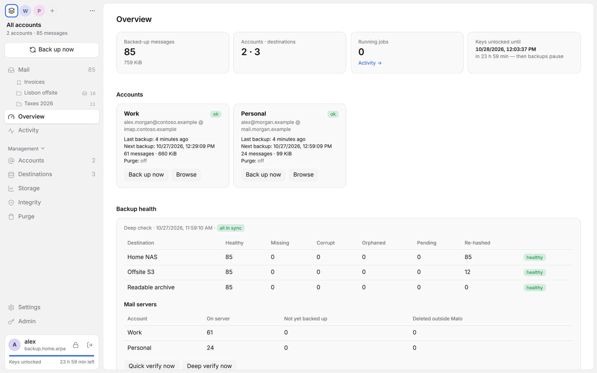
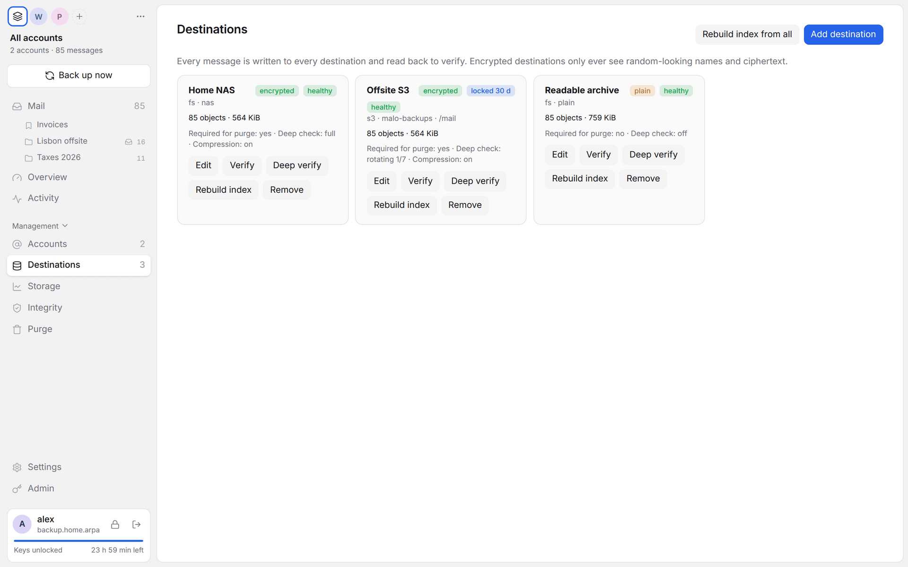
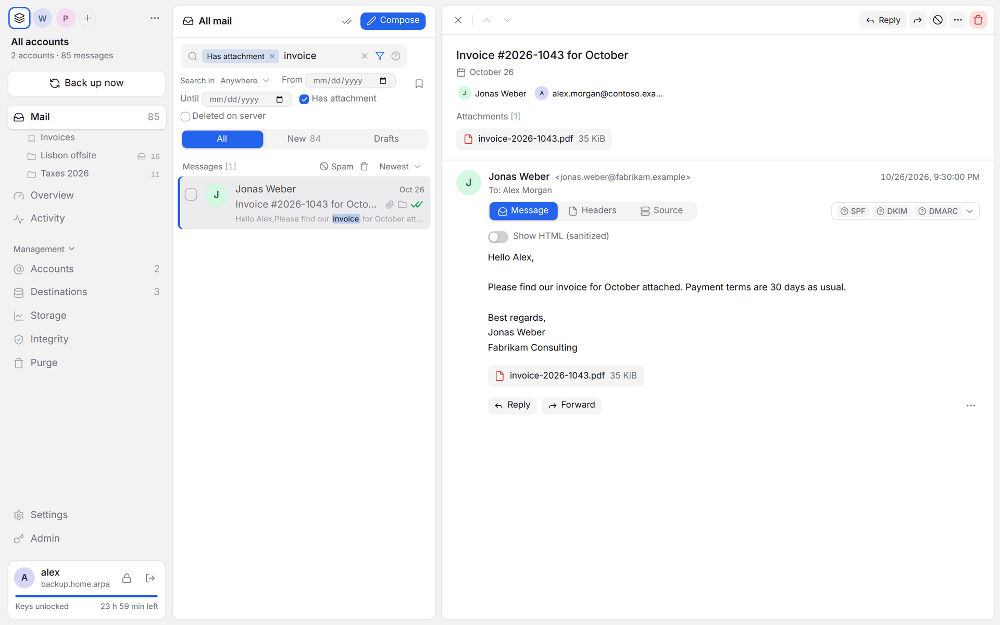
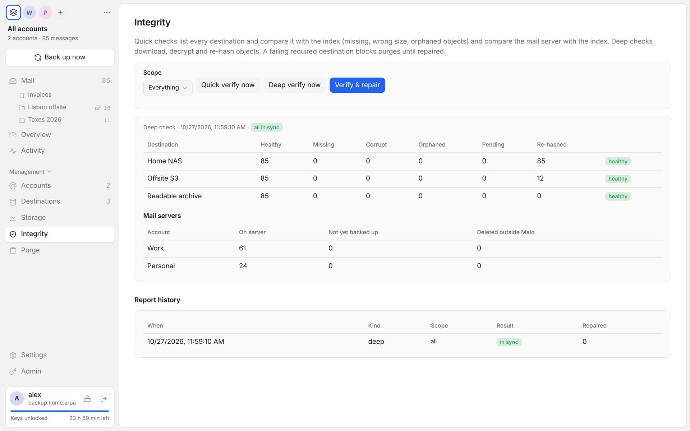
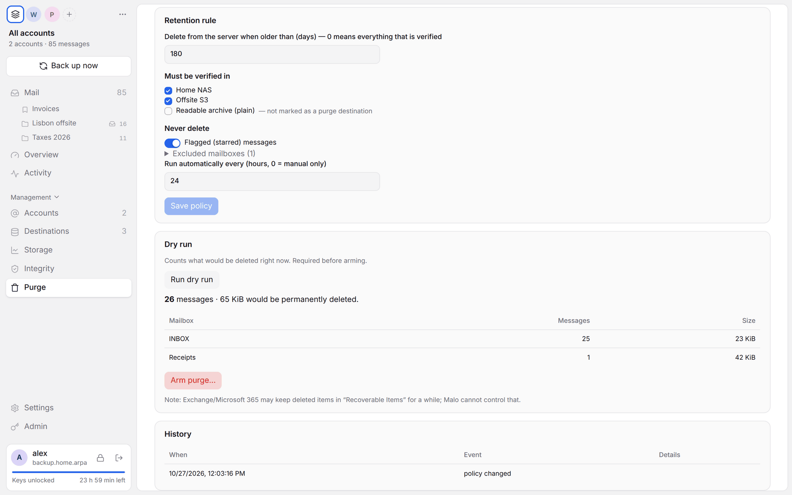
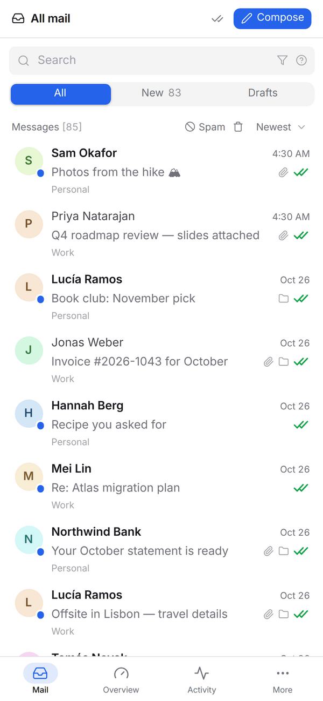
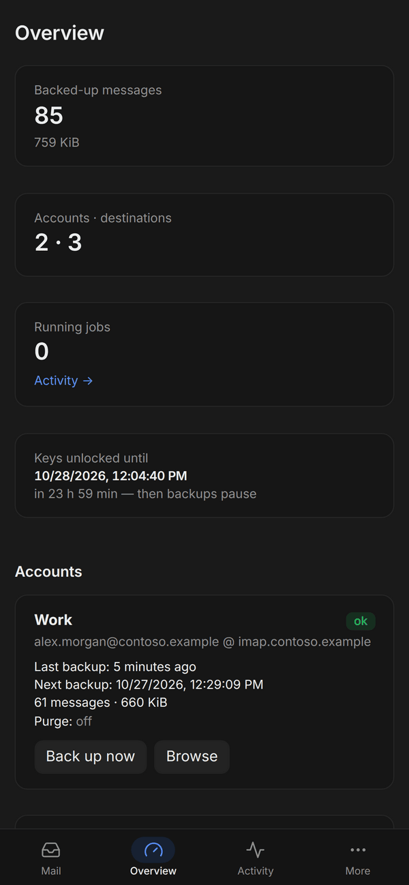

<div align="center">

# 📬 Malo

**Self-hosted email backup that keeps a verified copy of all your mail on storage you control.**

Run it on your NAS, home server or a small VPS. Malo copies every message from your IMAP accounts,<br>
encrypts it, stores it in as many places as you like, and keeps checking that the copies are still intact.


<picture>
  <source media="(prefers-color-scheme: dark)" srcset="docs/screenshots/viewer-dark.png">
  
</picture>

</div>

## 🤔 Why Malo?

Your mail provider is not a backup. Accounts get locked, mailboxes fill up, a sync client deletes the wrong folder, a provider shuts down. Malo gives you your own copy, on hardware or storage accounts you pay for and control, with nobody else holding the keys.

- 🏠 **Yours, end to end.** One Docker container on your own machine. No cloud service, no telemetry, no account with us.
- 🔐 **Encrypted at rest.** Keys are derived from your password and only exist in RAM while you're unlocked. Encrypted destinations see only random-looking names and ciphertext.
- 🧮 **Verified, not assumed.** Every write is read back and hashed. Scheduled checks re-download and re-hash, and repair broken copies from a healthy one.
- 🗄️ **Store it anywhere.** A folder on your NAS, any S3-compatible bucket (MinIO, RustFS, R2, Wasabi…), Backblaze B2, Google Cloud Storage, Azure Blob, WebDAV and more, via [Apache OpenDAL](https://opendal.apache.org). Use two or three at once.
- 🧹 **Free up your mailbox, safely.** Optionally delete old mail from the provider once it's verified everywhere you require. Dry run first, then arm it by typing the account name.
- ↩️ **Get it back out.** Restore to any IMAP account (the original or a new provider), or export as mbox, Maildir or `.eml` files.
- 👨‍👩‍👧 **Room for the household.** Family members can get their own login on your server. Each person has their own keys; even the admin can't read anyone else's mail.

## 📸 Screenshots

All screenshots show the real app with fictional demo data.

<table>
  <tr>
    <td width="50%">
      <b>Overview</b>: accounts, last backups and backup health at a glance<br><br>
      <picture>
        <source media="(prefers-color-scheme: dark)" srcset="docs/screenshots/dashboard-dark.png">
        
      </picture>
    </td>
    <td width="50%">
      <b>Destinations</b>: where your copies live, encrypted or plain<br><br>
      <picture>
        <source media="(prefers-color-scheme: dark)" srcset="docs/screenshots/destinations-dark.png">
        
      </picture>
    </td>
  </tr>
  <tr>
    <td width="50%">
      <b>Search</b>: full-text search across every account, with operators<br><br>
      <picture>
        <source media="(prefers-color-scheme: dark)" srcset="docs/screenshots/search-dark.png">
        
      </picture>
    </td>
    <td width="50%">
      <b>Integrity</b>: deep checks re-download and re-hash every copy<br><br>
      <picture>
        <source media="(prefers-color-scheme: dark)" srcset="docs/screenshots/integrity-dark.png">
        
      </picture>
    </td>
  </tr>
  <tr>
    <td width="50%">
      <b>Purge</b>: a dry run shows exactly what would be deleted from the server<br><br>
      <picture>
        <source media="(prefers-color-scheme: dark)" srcset="docs/screenshots/purge-dark.png">
        
      </picture>
    </td>
    <td width="50%" align="center">
      <b>Phone layout</b><br><br>
      
      &nbsp;
      
    </td>
  </tr>
</table>

## 🚀 Quick start

You need a machine that stays on (a NAS, a mini PC, a Raspberry Pi-class box or a VPS) with Docker.

**1. Start the server**

```sh
git clone <this repository> malo && cd malo
docker compose up -d malo
```

**2. Note the setup token and certificate fingerprint**

```sh
docker compose logs malo | grep -E "setup token|certificate SHA-256"
```

Malo creates its own small certificate authority on first start, so the connection is encrypted even on your LAN without a domain or Let's Encrypt.

**3. Connect with the desktop app**

Build the app (see [Desktop app](docs/desktop-app.md)), choose **Remote server**, enter `https://<your-server>:8443`, check that the fingerprint matches the log, and create your admin user with the setup token. Save the **recovery kit** when asked: it's the only way back in if you forget your password.

**4. Add a destination and an account**

Add at least one destination (a mounted NAS folder is the easiest start; add an offsite bucket too), then add your mail account. Presets cover Gmail, Outlook/Microsoft 365, Yahoo, iCloud and Fastmail, with app passwords or OAuth2 using your own client ID. Backups start right away and then run every 30 minutes, or instantly on new mail with IMAP IDLE.

> 💡 **Just want to try it?** The desktop app can also run the bundled server locally, with no Docker at all. Choose **Use local server** on the first screen.

## ✨ Features

### 📥 Backup

- Copies every message **byte for byte** using `BODY.PEEK[]`, so Malo never marks mail as read.
- Backs up all folders, including Gmail's *All Mail*, *Spam* and *Trash*, with labels kept and duplicates removed.
- Runs on a schedule and on **IMAP IDLE** for new mail. A live *Newly found* list shows messages as they're discovered.
- Encrypted destinations **compress** mail with zstd first, which usually halves the space it takes.
- **S3 Object Lock / B2 File Lock** can protect copies from deletion, even with a stolen storage key.
- Per-destination **speed limits** and a **cost estimate** per GB-month.

### 🛡️ Integrity and repair

- Quick checks compare each destination's listing with the index, daily by default.
- Deep checks download, decrypt and re-hash, weekly by default, or a rotating slice per run for destinations with expensive egress.
- *Verify & repair* copies a healthy replica back, or fetches the message from the mail server again.

### 🔎 Reading your archive

- A built-in mail client for your backups: threaded conversations, **full-text search** (`from:`, `has:attachment`, `after:2024-03`, `"exact phrase"`, `-word`…), saved searches and hand-made **collections**.
- A **sandboxed viewer**: HTML sanitized on the server, remote images blocked, links shown with their real target, SPF/DKIM/DMARC results, warnings for look-alike senders and risky attachments.
- Reply, forward and compose through the account's own SMTP server.
- 📱 **Use your usual mail app** too: Malo can serve your archive over IMAP (including mail long deleted from the provider), so Apple Mail or Thunderbird on your phone can browse it. See [Mail apps](docs/mail-apps.md).

### 🧹 Purge (opt-in)

- Delete old mail from the provider **only after** it is verified in every destination you require.
- Rules for age, required destinations, excluded folders and flagged mail. Always dry-run first, then arm by typing the account name; any change disarms it.
- Each candidate is re-verified and identity-checked right before deletion. Only `UID EXPUNGE` is used, never a bare `EXPUNGE`.

### ↩️ Restore and export

- Upload messages, a search, a folder or a whole account back to **any IMAP account**: the original after a loss, or a new provider when you move. Folders, flags and dates come along, and re-running skips what's already there.
- Export as **mbox**, **Maildir** or a zip of `.eml` files.
- Lost the whole server? Install Malo anywhere, choose *Restore from kit*, and it rebuilds your accounts, settings and mail index from your destinations.

### 🔔 No silent failures

Alerts through **ntfy**, a **webhook**, an [**Apprise**](https://github.com/caronc/apprise-api) server (Telegram, Slack, Matrix, Signal…) or **email** when backups keep failing, a check finds damaged copies, a sign-in expires or a destination stops answering.

## 🔐 Security in short

```
password ──Argon2id──► key-encryption key (never stored)
                         └─► master key (in RAM only while unlocked)
                               ├─► encrypted settings and credentials
                               ├─► encrypted search index (SQLCipher)
                               └─► archive key ─► AES-256-GCM per message
```

- **Auto-lock is mandatory.** After 24 hours (or sooner, if you set it), or on *Lock now* or a restart, the server wipes your keys from memory. Scheduled jobs wait until you unlock again.
- **No backdoor.** Forget your password and you'll need your **recovery kit**, a file encrypted with its own passphrase. Optional two-step login (TOTP) is available.
- **Hardened container:** non-root, read-only, distroless, no core dumps or ptrace, key material `mlock`ed.
- The desktop app pins your server's certificate and keeps its session token out of the web view.

The full write-up, including the key hierarchy, path and Unicode handling and the viewer's sandbox, is in [docs/security.md](docs/security.md).

## 🏗️ How it fits together

```
┌──────── Desktop app (Tauri) ─────────┐          ┌──────── malo-server (Docker on your box) ─────────┐
│ Svelte UI                            │   TLS    │ HTTPS API + live events                           │
│ pinned certificate · OAuth sign-in   │◄────────►│ per-user keys in RAM · scheduler · job queue      │
│ or: runs the server locally          │          │ IMAP backup · verify · purge · restore · search   │
└──────────────────────────────────────┘          └───────────────┬───────────────────────────────────┘
       Mail apps (IMAP/SMTP, optional) ◄──────────────────────────┤
                                                                  ▼
                                    NAS folder · S3 / MinIO / R2 · B2 · GCS · Azure · WebDAV
```

## 📚 Documentation

| | |
|---|---|
| 🐳 [Running the server](docs/self-hosting.md) | Docker, TLS and certificates, configuration variables, reverse proxies, hardening |
| 📖 [User guide](docs/user-guide.md) | Destinations, accounts, backups, integrity, purge, search, restore, export, alerts, collections |
| 📱 [Mail apps](docs/mail-apps.md) | Reading your archive in Apple Mail, Thunderbird or on your phone over IMAP and SMTP |
| 🖥️ [Desktop app](docs/desktop-app.md) | Building, profiles, local mode, tray mode |
| 🔐 [Security model](docs/security.md) | Keys, recovery kit, two-step login, storage layout, viewer sandbox |
| 🧪 [Development and tests](docs/development.md) | Architecture, test stack, GUI tests, lifecycle and parser fuzzing |

## ⚠️ Status

Malo is young. It has a broad test suite, including a stateful fuzzer that throws storage faults, network cuts, restarts and hostile names at the whole server and checks that no mail is ever lost. Even so, the Gmail-specific paths and the Google and Microsoft OAuth endpoints haven't been run against the real services in this repository's tests: check them with your own accounts before you rely on **purging**. Backing up is safe to try: Malo only reads from your mail server unless you arm a purge or delete, move or restore mail yourself.

## 📄 License

[Apache License 2.0](LICENSE)
